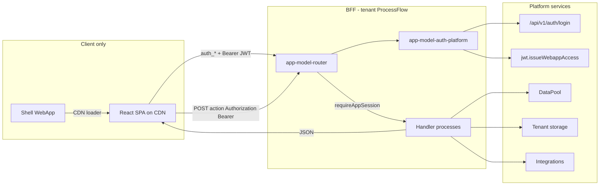

# Architecture

## Overview



## Authentication model

This app model uses **platform users** for credential verification and a **WebApp JWT** (`type: webapp_access`) for the browser session:

1. Users are created in the platform `Users` table with role `user` (not `tenant_admin`).
2. SPA POSTs `auth_login` to the WebApp.
3. Auth handler calls platform `/api/v1/auth/login` **only to verify credentials**. The **router** (WebApp entry process) then issues a WebApp JWT via `jwt.issueWebappAccess` — nested handler processes do not have `webapp_id` context.
4. SPA stores the JWT in memory + `sessionStorage` (`tokenStore`) and sends `Authorization: Bearer` on later calls.
5. Deploy sets WebApp `auth_transport: "bearer"` and `auth_require: false` (login must stay public).
6. Runtime verifies the JWT and injects `process_input.auth` / `process_input.auth_token`. The router uses `requireAppSession` and passes `app_user` to handlers.
7. `tenant_admin` / `admin` / `super_admin` are rejected at SPA and BFF.

The WebApp's `webapp_user_id` is a separate platform user used for **process execution context** — it is not the end-user identity.

See platform guide: [WebApps Authentication](https://tealfabric.io/docs/05_apps-webhooks-and-surfaces/webapps/46-Webapps_Authentication).

## BFF pattern

Request envelope (AGENTS.md):

```json
{ "action": "list_items", "payload": { "limit": 50 } }
```

The SPA `callBff` helper accepts a flat typed object and wraps it into `{ action, payload }` automatically. Auth is Bearer JWT (`Authorization` header; also `access_token` in payload as a fallback).

Response envelope:

```json
{ "success": true, "data": { ... } }
```

Never embed `X-API-Key` in CDN JavaScript.

BFF calls POST `{ action, payload }` to the **WebApp shell URL** (basename / first path segment), never to nested SPA routes such as `/login`.

## UI delivery

1. `npm run build` → `frontend/dist/`
2. Upload to `CDN/app-model/` via documents API
3. WebApp shell (`WEBAPP.md`) fetches `index.html` and rewrites asset URLs
4. Deploy sets `custom_security_policy` so CDN `connect-src` / `script-src` / `style-src` are allowed

## Handler processes

| Action | Handler | Capabilities |
|--------|---------|--------------|
| `health` / `ping` | router (inline) | context |
| `auth_login` / `auth_logout` / `auth_bootstrap` / `auth_session` | app-model-auth-platform | api |
| `list_items` | app-model-list-items | data-access |
| `create_item` | app-model-create-item | data-access |
| `list_files` | app-model-list-files | file |
| `upload_file` | app-model-upload-file | file |
| `list_integrations` | app-model-list-integrations | api |
| `integration_status` | app-model-integration-status | connector |
